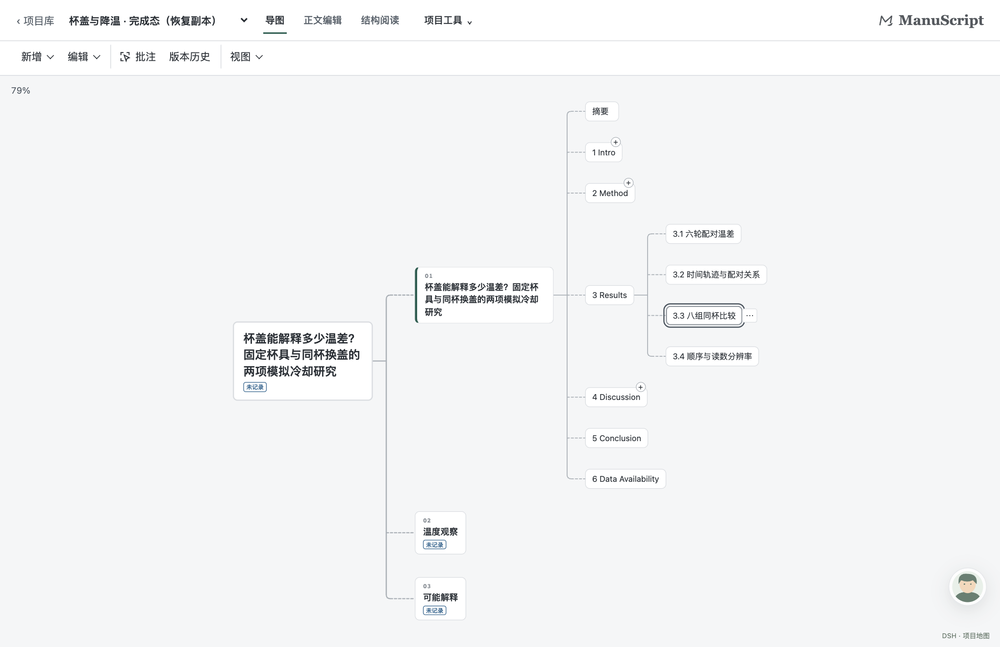
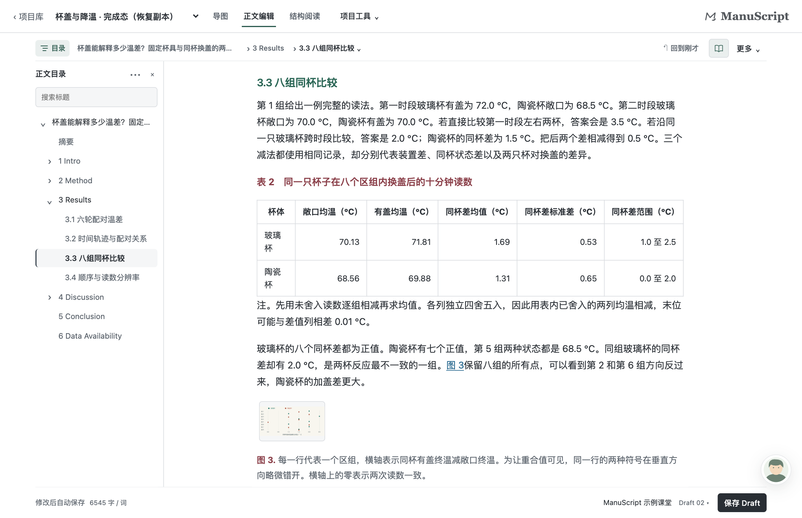
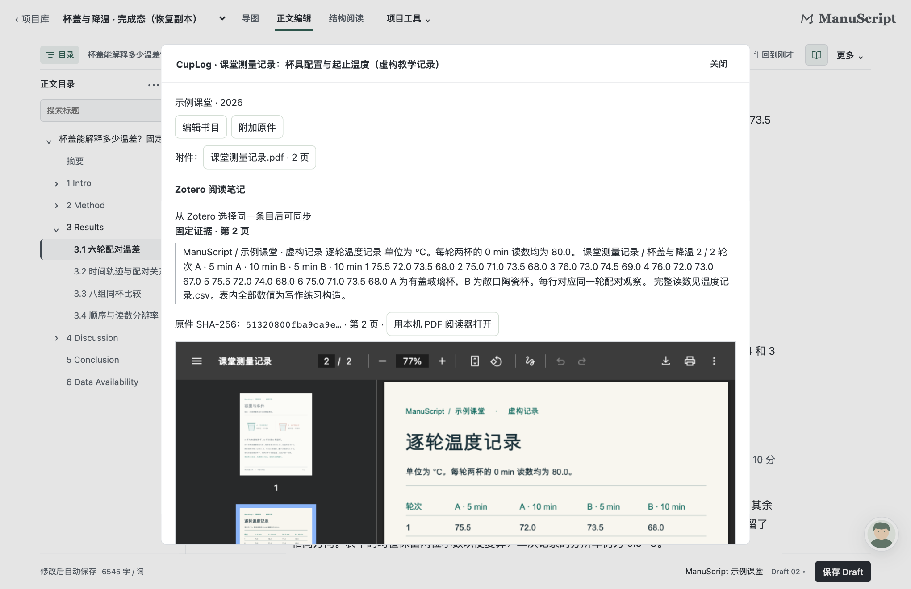

# ManuScript

[简体中文](README.md) · **English**

ManuScript is a local workspace for research writing. Lay out a paper in a chapter map, follow a citation to the page that supports it, and match a Word comment to the exact passage your reviewer read.

[Download v0.13.0 public beta](https://github.com/RJ2045-PRC/ManuScript/releases/tag/v0.13.0) · [Read the sample paper (Chinese)](examples/杯盖与降温/稿件/Draft-02.md) · [Install with an agent](#install-with-an-agent)



*In the cup-cooling example, expand 3 Results to see four subsections. Select 3.3 and choose “⋯ → 定位正文” to jump from the map to the experiment in the manuscript.*

## Screenshots

**From a claim to the data.** The first draft says, “The lid slowed cooling.” A reviewer spots a problem. One cup was glass and the other ceramic, so how much of the difference came from the lid? Section 3.3 of the revision compares each cup with and without its lid. Section 4.1 revisits the claim. These screenshots show the completed project bundled with v0.13.0, running in DSH Web 0.2.2-rc.1 on macOS. The sample and the interface shown are in Chinese.



<details>
<summary>Follow a citation to page 2 of the measurement log</summary>

Open the classroom measurement citation in section 3.1. The source window shows the pinned passage alongside the original PDF, open to the round-by-round temperature readings.



</details>

<details>
<summary>Read the discussion paragraph by paragraph</summary>

Select section 4.1 in structural reading. The left pane separates the argument into paragraph cards. The manuscript view on the right keeps the paragraphs in context as the discussion continues into section 4.2.


</details>

## Try the paper

| Starting point | What you get |
|---|---|
| [Read the revision on GitHub](examples/杯盖与降温/稿件/Draft-02.md) · [Download the PDF](examples/杯盖与降温/稿件/Draft-02-修订稿.pdf) | An original simulated study with six chapters, 14 numbered subsections, figures, tables, equations and APA 7 references. |
| Open **载入杯盖与降温示例** after installation | Inspect both saved Drafts, citations pinned to source pages, and the review comment the author accepted. |
| [Follow the walkthrough (Chinese)](examples/杯盖与降温/README.md) · [Open the annotated Word file](examples/杯盖与降温/稿件/Draft-01-审阅回稿.docx) | Restore the starter project, write from idea cards, save Draft 01, import the Word comment, check the evidence and export Draft 02. This exercise works offline. |

The working manuscript saves automatically. Choose **保存 Draft** (Save Draft) to create the first numbered snapshot or preserve a changed manuscript. The release workflow diagram was made with Archify 3.2.0 by tt-a1i. [Diagram, interactive version and source (Chinese)](docs/07-manuscript-workflow.md) · [Archify](https://github.com/tt-a1i/archify)

## Install with an agent

Copy the whole block to an agent that can use your terminal. Add “Use Codex” or “Use DSH Web” if you have chosen a host.

```text
Install and verify ManuScript v0.13.0 on this computer. The official repository is https://github.com/RJ2045-PRC/ManuScript .
Read “Platform support” and “Manual installation” in README.en.md on the default branch. Identify the OS and shell. Use my chosen host, or ask whether I want Codex or DSH Web.
Check out tag v0.13.0 in a separate directory. Run setup and doctor for this platform and use the project virtual environment. For Codex, register the local marketplace and install manuscript@manuscript-lab. For DSH Web on macOS, launch an isolated instance. Explain the launcher limitation if I request native Windows DSH.
Load a copy of the bundled cup-cooling example and check for Draft 01 and Draft 02. Report the steps completed, host version and where to open the plugin. Tell me if I need to restart the desktop app. Preserve my existing projects, plugin settings and credentials.
```

## Platform support

| Platform | Codex | Standalone DSH Web preview |
|---|---|---|
| macOS | The MCP App entry point was tested with the packaged plugin. Restart Codex and open ManuScript from **More / Explore**. | Loading the sample, saving a Draft and exporting a PDF were tested with DSH 0.2.2-rc.1. The screenshots above use this setup. |
| Native Windows | PowerShell instructions are provided below. The v0.13.0 MCP manifest launches `./server.mjs` directly. Desktop launch, project I/O and export still need testing on Windows. | The v0.13.0 launcher exits on `win32`. WSL requires a compatible Linux DSH runtime and has not been tested for this release. |

## Manual installation

Install Git, Node.js 24.9 or later, Python 3.11 or later, Pandoc, Poppler (`pdftoppm`) and LibreOffice (`soffice`). Start with your operating system below, then follow the instructions for your host. Codex and DSH have separate project stores. To move a project between them, export its ZIP and restore it in the other host.

<details>
<summary>macOS terminal</summary>

```sh
git clone --branch v0.13.0 https://github.com/RJ2045-PRC/ManuScript.git
cd ManuScript
npm run setup
npm run doctor
export MANUSCRIPT_PYTHON="$PWD/.venv/bin/python3"
```

</details>

<details>
<summary>Windows PowerShell</summary>

For a native Windows Codex trial, make `node`, `npm.cmd`, `pandoc`, `pdftoppm` and `soffice` available in PowerShell. The commands use the Python Launcher to locate Python 3.11 or later. If you only have `python.exe`, set `MANUSCRIPT_BOOTSTRAP_PYTHON` to its full path instead.

```powershell
git clone --branch v0.13.0 https://github.com/RJ2045-PRC/ManuScript.git
Set-Location ManuScript
$env:MANUSCRIPT_BOOTSTRAP_PYTHON = py -3 -c "import sys; print(sys.executable)"
npm.cmd run setup
if ($LASTEXITCODE -ne 0) { throw "ManuScript setup failed" }
$env:MANUSCRIPT_PYTHON = (Resolve-Path ".venv/Scripts/python.exe").Path
npm.cmd run doctor
if ($LASTEXITCODE -ne 0) { throw "ManuScript doctor failed" }
```

Once the checks pass, continue with Codex below.

</details>

<details>
<summary>Launch DSH Web on macOS</summary>

With a compatible DSH installation on your Mac, run this in the same terminal used for setup.

```sh
node scripts/dsh-preview.mjs
```

The launcher extracts the runtime from DSH NEXT, creates an isolated profile and prints the log location. Open the local URL following `dsh web:` in that log. Complete the host sign-in or API key setup if prompted, then select ManuScript in the sidebar. To inspect the sample offline, first open the local URL, then open a second tab on the same protocol, host and port at `/api/manuscript.workspace`. Click **载入杯盖与降温示例**. Each launch uses a fresh project library, so export a project ZIP before closing if you want to keep your work. The plugin declares support for DSH 0.2.1-rc.4 and 0.2.2-rc.1. If you have a complete runtime, point `MANUSCRIPT_DSH_RUNTIME` at its directory.

</details>

<details>
<summary>Register and open the Codex plugin</summary>

With the Codex CLI installed, run these commands from the repository root. On macOS use:

```sh
codex plugin marketplace add "$PWD"
codex plugin add manuscript@manuscript-lab
```

In Windows PowerShell use:

```powershell
codex plugin marketplace add (Get-Location).Path
codex plugin add manuscript@manuscript-lab
```

Check the installation with `codex plugin list --json`. Quit Codex completely and restart it from the environment where you set `MANUSCRIPT_PYTHON`. Open ManuScript from **More / Explore**, select **载入杯盖与降温示例** and look for Draft 01 and Draft 02. If the MCP process fails to launch on Windows, include the OS, Codex version and startup error in your issue.

</details>

## Guides and feedback

- The [user guide (Chinese)](docs/01-README.md) covers writing, snapshots, citations, review and export. The [plugin manual (Chinese)](packages/ManuScript/README.md) lists the host entry points.
- The release includes the built plugin in `manuscript-0.13.0.tgz`. Verify downloads against `SHA256SUMS.txt`. The source tree also includes the built workbench. After editing source, run `npm run build`, then `npm test` to check the MCP App entry point.
- Model conversations and assisted restructuring require a model configured in the host. Scanned-document OCR and lossless round trips for arbitrary Word styles or complex multi-file LaTeX projects have not been verified.

For a bug report, include the ManuScript version, host and host version, steps to reproduce, and expected and actual results. The simulated paper is available for reproductions. [Open an issue](https://github.com/RJ2045-PRC/ManuScript/issues)

## License

ManuScript’s original code, documentation and public sample are released under the [MIT License](LICENSE). Third-party code, citation styles and teaching materials carry their respective credits and licenses. [Third-party notices](packages/ManuScript/THIRD-PARTY.md)
