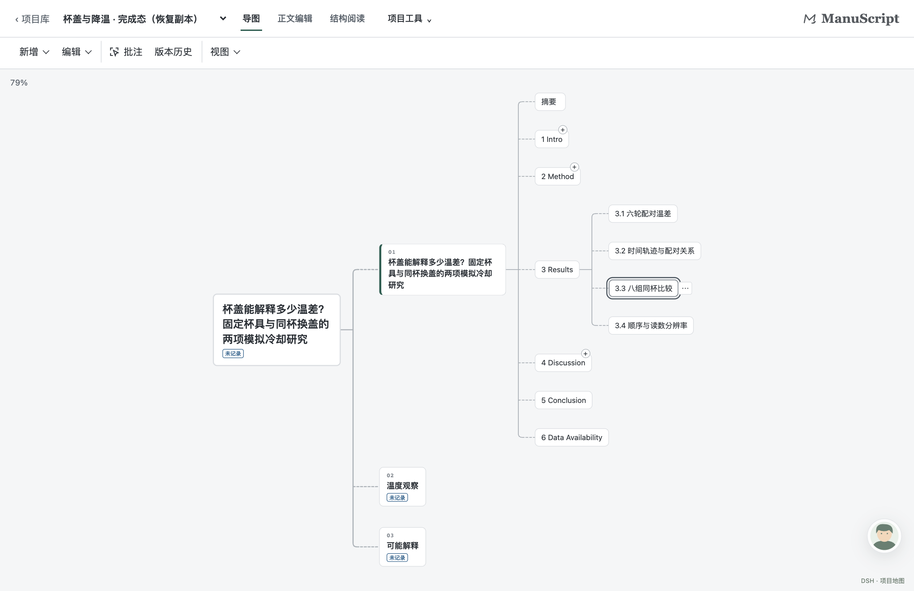
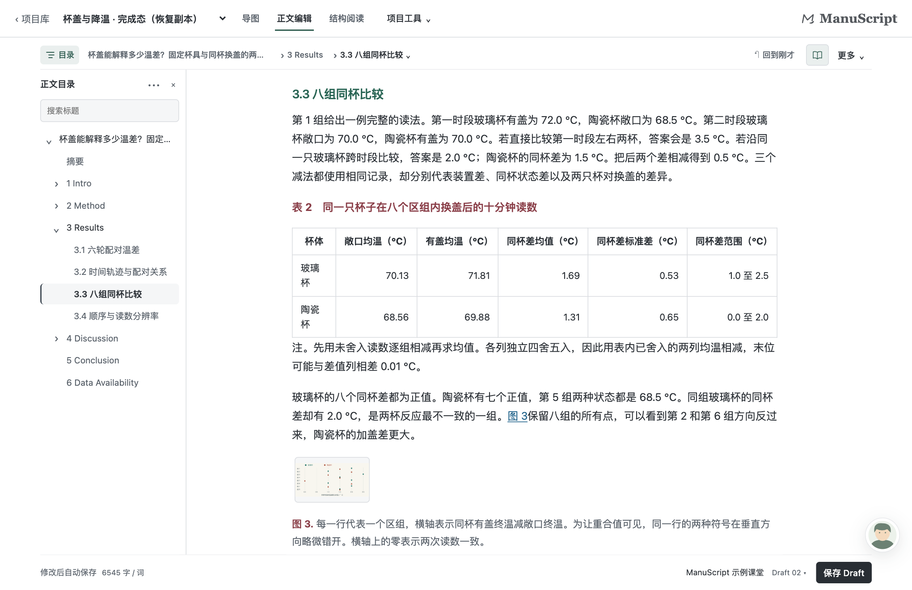
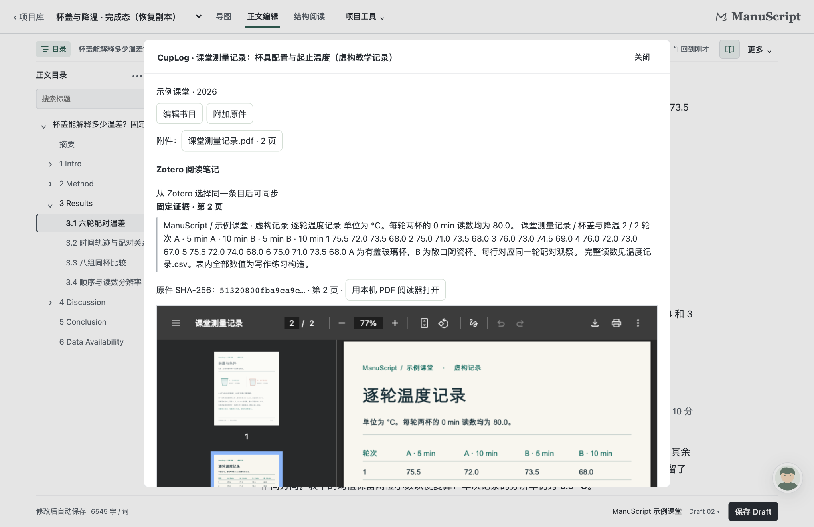
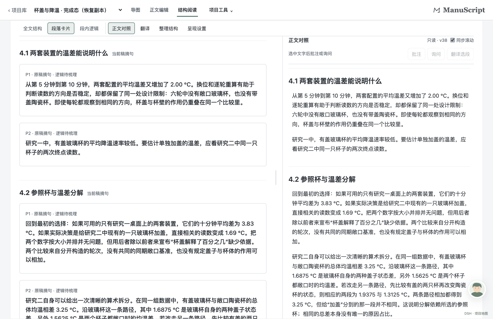

# ManuScript

**简体中文** · [English](README.en.md)

ManuScript 是一个本地论文写作工作台。你可以在导图里搭章节，从正文引文跳到来源 PDF 的具体页，再把 Word 批注对回审阅人读到的那一版。

[下载 v0.13.0 首次公开测试版](https://github.com/RJ2045-PRC/ManuScript/releases/tag/v0.13.0) · [阅读示例论文](examples/杯盖与降温/稿件/Draft-02.md) · [复制给 Agent 安装](#复制给-agent-安装)



*在「杯盖与降温」示例中，展开 3 Results 可以看到四个结果小节。选中 3.3，点「⋯ → 定位正文」就能读到对应的实验结果。*

## 实机截图

**从章节读到数据。** 首稿里有一句「杯盖减缓了降温。」审阅人问，一只是玻璃杯，另一只是陶瓷杯，怎么知道温差来自盖子？修订稿在 3.3 节列出同一只杯子分别加盖和敞口时的读数，再在 4.1 节收窄结论。以下截图取自 macOS 上的 DSH Web 0.2.2-rc.1，载入的是 v0.13.0 插件内置的完成态项目。



<details>
<summary>查看引文如何定位到原始记录的第 2 页</summary>

在 3.1 节点开课堂测量记录的引文，来源窗口会同时显示固定的证据片段和 PDF 第 2 页的逐轮读数。



</details>

<details>
<summary>查看讨论段落与正文如何并排核对</summary>

在「结构阅读」选中 4.1，左侧按段拆开论证，右侧保留连续正文，可接着读 4.2 的温差分解。



</details>

## 试读或亲手走一遍

| 从哪里开始 | 可以看到什么 |
|---|---|
| [在线读修订稿](examples/杯盖与降温/稿件/Draft-02.md) · [下载 PDF](examples/杯盖与降温/稿件/Draft-02-修订稿.pdf) | 一篇含六章、14 个编号子节的原创模拟研究，包含图表、公式和 APA 第 7 版引文。 |
| 安装后点「载入杯盖与降温示例」 | 直接查看完成态的两版 Draft、固定到页的引文，以及已采纳的审阅意见。 |
| [跟随示例导读](examples/杯盖与降温/README.md) · [查看 Word 回稿](examples/杯盖与降温/稿件/Draft-01-审阅回稿.docx) | 恢复起点项目，选卡起草，保存 Draft 01，导入 Word 批注、核对证据，导出 Draft 02。基础练习可离线完成。 |

工作稿自动保存；点击「保存 Draft」会为首次保存或有改动的稿件留下编号快照。发布版流程图使用 Archify 3.2.0（tt-a1i）制作。[流程图、交互版与图源](docs/07-manuscript-workflow.md) · [Archify](https://github.com/tt-a1i/archify)

## 复制给 Agent 安装

将以下整段交给可以操作本机终端的 Agent。已选定宿主时，可在末尾加上「使用 Codex」或「使用 DSH Web」。

```text
请在本机安装并验证 ManuScript v0.13.0。官方仓库是 https://github.com/RJ2045-PRC/ManuScript 。
先读默认分支 README 的「平台支持」和「安装与启动」。识别系统和 Shell，使用我指定的宿主；不明确时问我选 Codex 还是 DSH Web。
在独立目录检出 v0.13.0，使用项目虚拟环境，按对应平台执行 setup 和 doctor。Codex 注册本地 marketplace 并安装 manuscript@manuscript-lab；macOS 的 DSH Web 启动独立试用实例。原生 Windows 的 DSH 启动器有限制，请向我说明。
用内置示例副本验证能否看到 Draft 01 和 Draft 02。报告已完成步骤、宿主版本和打开入口；需要我重启桌面应用时告诉我。保留现有项目、插件配置和凭据。
```

## 平台支持

| 系统 | Codex | DSH Web 独立试用 |
|---|---|---|
| macOS | 已验证本地插件包的 MCP App 入口。安装后重启 Codex，从「更多 / Explore」打开。 | 已在 DSH 0.2.2-rc.1 验证载入示例、保存 Draft 和导出 PDF。首页实机截图来自这一路径。 |
| Windows 原生 | 下方提供 PowerShell 环境检查与插件注册命令。v0.13.0 的 MCP 清单直接启动 `./server.mjs`，桌面宿主加载、读写与导出尚待 Windows 实机验证。 | v0.13.0 启动器会在 `win32` 退出。WSL 需要另备兼容的 Linux DSH 运行时，本版未验证这条路径。 |

## 安装与启动

准备 Git、Node.js 24.9 或以上、Python 3.11 或以上、Pandoc、Poppler（`pdftoppm`）和 LibreOffice（`soffice`）。DSH 与 Codex 分别存储项目，跨宿主使用时可以导出项目包再恢复。

<details>
<summary>macOS 终端</summary>


```sh
git clone --branch v0.13.0 https://github.com/RJ2045-PRC/ManuScript.git
cd ManuScript
npm run setup
npm run doctor
export MANUSCRIPT_PYTHON="$PWD/.venv/bin/python3"
```

</details>

<details>
<summary>Windows PowerShell</summary>


以下命令用于原生 Windows 的 Codex 试装。先让 `node`、`npm.cmd`、`pandoc`、`pdftoppm` 和 `soffice` 可从当前 PowerShell 调用。使用 Windows Python Launcher 找到 Python 3.11 或以上的解释器；只有 `python.exe` 时，可直接将其绝对路径赋给 `MANUSCRIPT_BOOTSTRAP_PYTHON`。

```powershell
git clone --branch v0.13.0 https://github.com/RJ2045-PRC/ManuScript.git
Set-Location ManuScript
$env:MANUSCRIPT_BOOTSTRAP_PYTHON = py -3 -c "import sys; print(sys.executable)"
npm.cmd run setup
if ($LASTEXITCODE -ne 0) { throw "ManuScript setup failed" }
$env:MANUSCRIPT_PYTHON = (Resolve-Path ".venv/Scripts/python.exe").Path
npm.cmd run doctor
if ($LASTEXITCODE -ne 0) { throw "ManuScript doctor failed" }
```

环境检查通过后，按下方 Codex 步骤注册插件并验证宿主能否打开项目。

</details>

<details>
<summary>启动 DSH Web（macOS）</summary>


在 macOS 安装兼容的 DSH 后，在完成环境检查的终端执行下列命令。它会从本机 DSH NEXT 提取运行时，为此轮试用创建独立配置，并将日志文件的位置显示在终端。打开日志中 `dsh web:` 后的本机地址，若新配置出现 DSH 的登录或 API Key 设置页，按宿主提示完成设置后，从侧栏选择 ManuScript。要先离线查看示例，可在打开本机地址后，在同一浏览器另开标签页，保留协议、主机和端口，将路径改为 `/api/manuscript.workspace`，点「载入杯盖与降温示例」。每次启动都会使用新的项目库，结束前可导出项目 ZIP。插件声明支持 DSH 0.2.1-rc.4 和 0.2.2-rc.1。已有完整运行时可通过 `MANUSCRIPT_DSH_RUNTIME` 指定目录。

```sh
node scripts/dsh-preview.mjs
```

</details>

<details>
<summary>注册并打开 Codex 插件</summary>


安装 Codex CLI 后，在仓库根目录注册本地插件市场并安装。macOS 终端使用以下命令。

```sh
codex plugin marketplace add "$PWD"
codex plugin add manuscript@manuscript-lab
```

Windows PowerShell 试装时，使用目录的完整字符串路径。

```powershell
codex plugin marketplace add (Get-Location).Path
codex plugin add manuscript@manuscript-lab
```

用 `codex plugin list --json` 核对安装记录。完整退出并从设置了 `MANUSCRIPT_PYTHON` 的环境重启 Codex，在「更多 / Explore」打开 ManuScript。点「载入杯盖与降温示例」，确认可以看到 Draft 01 和 Draft 02。若 Windows 宿主无法启动 MCP 进程，请在反馈中附上系统、Codex 版本和启动错误。

</details>

## 使用范围与反馈

- [使用指南](docs/01-README.md)说明如何编辑、留版、核对来源、处理返修与导出。[插件手册](packages/ManuScript/README.md)列出各宿主入口。
- Release 中的 `manuscript-0.13.0.tgz` 是已构建的插件包。源码树也包含工作台构建产物，修改源码后运行 `npm run build`，运行 `npm test` 验证 MCP App 入口。下载附件可对照 `SHA256SUMS.txt`。
- 示例的写作与返修练习可离线完成。调用模型对话或整理结构时，需要宿主配置可用的模型。扫描件 OCR、任意 Word 样式与复杂多文件 LaTeX 工程的无损往返尚未验证。

遇到问题时，请注明 ManuScript 版本、宿主及版本、操作步骤，以及预期和实际结果。可用随附的模拟稿复现。[提交 GitHub Issue](https://github.com/RJ2045-PRC/ManuScript/issues)

## 许可证

ManuScript 自有代码、文档和原创公开示例采用 [MIT](LICENSE)。第三方代码、引用样式和教学材料的出处及适用许可见[第三方说明](packages/ManuScript/THIRD-PARTY.md)。
