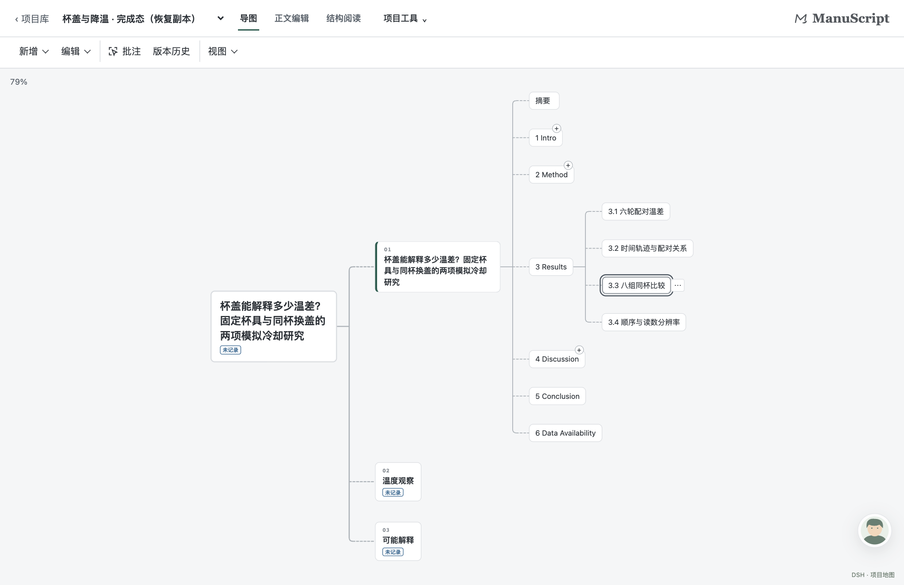
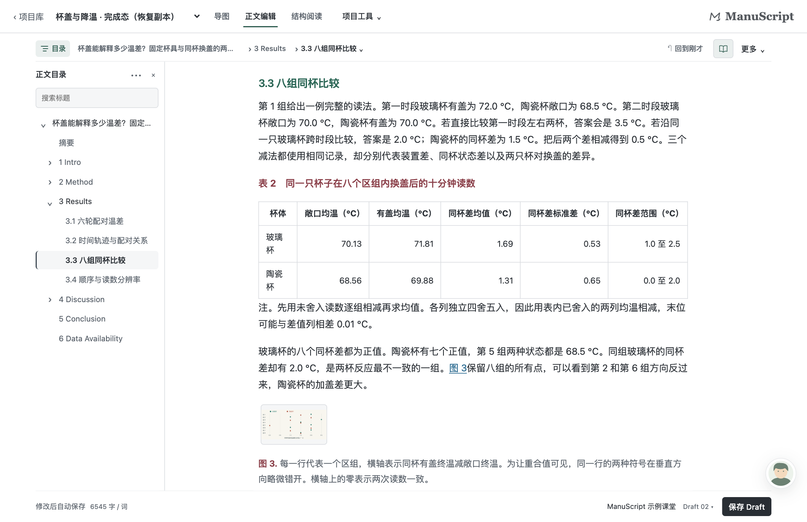
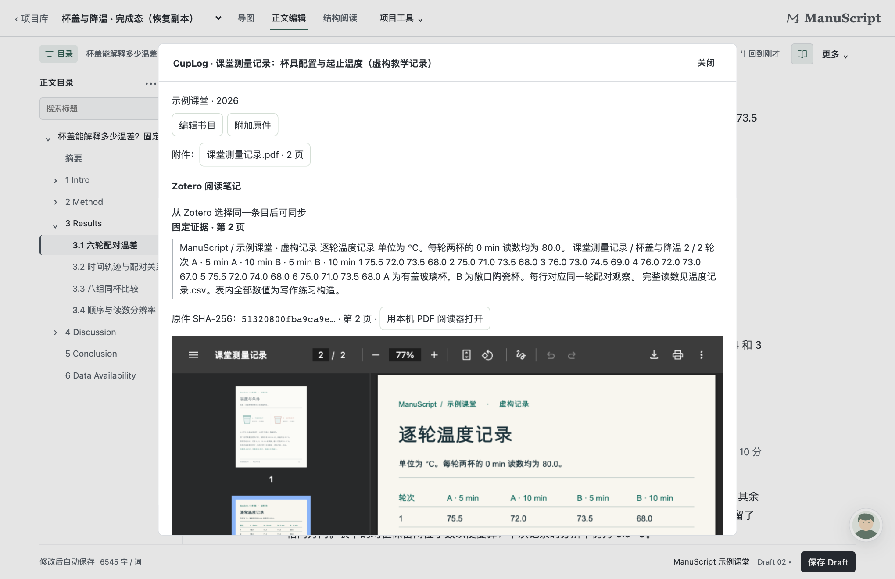

<h1 align="center"> ManuScript</h1>

<p align="center"><strong>简体中文</strong> · <a href="README.md">English</a></p>

ManuScript 是一个本地论文写作工作台。在章节导图里找到要改的段落，从正文引文打开来源 PDF，再把 Word 审阅意见对回当时送审的那句话。

**v0.13.1 是 DSH 商城公测版。**

**[打开交互演示](https://rj2045-prc.github.io/ManuScript/)** · [复制给 Agent 安装](#复制给-agent-安装) · [下载公测版](https://github.com/RJ2045-PRC/ManuScript/releases/tag/v0.13.1) · [查看平台支持](#平台支持)

## 实机截图



*「杯盖与降温」示例的章节导图。选中 3.3，在节点旁点「⋯ → 定位正文」即可读到对应结果。截图来自 macOS 上的 DSH Web 0.2.2-rc.1，使用 v0.13.0 公测插件。*

## 跟着一条返修意见试用

首稿写道：“杯盖减缓了降温。”审阅人发现，有盖的是玻璃杯，敞口的是陶瓷杯。观察到的温差究竟来自杯盖，还是两只杯子本身？可以在浏览器里沿着这条意见核对整篇稿件。

| 在演示中打开 | 可以亲手核对什么 |
|---|---|
| [章节导图](https://rj2045-prc.github.io/ManuScript/#map) | 展开 2 Method，选 2.2，再从节点跳到完整正文。 |
| [2.2 正文与引文](https://rj2045-prc.github.io/ManuScript/#read/2.2/02) | 点课堂记录的引文，到 PDF 第 1 页核对装置。在 3.1 点击同一来源的引文，可看第 2 页逐轮读数。 |
| [3.3 同杯比较](https://rj2045-prc.github.io/ManuScript/#read/3.3/02) | 读表 2，看同一只杯子分别加盖和敞口时的终点温度。 |
| [全文结构](https://rj2045-prc.github.io/ManuScript/#structure) | 从全文问题开始，展开章节关联，查看方法、结果和讨论怎样相互对应。 |
| [4.1 段落卡与返修](https://rj2045-prc.github.io/ManuScript/#structure/4.1/02/cards/2/2) | 打开已整理的第二张段落卡，展开段内逻辑，选节点核对原句，再看两版稿件与 Word 批注。 |

<details>
<summary>查看正文、来源页和结构阅读的实机截图</summary>

**正文。** 目录定位到 3.3，表 2 并列给出两只杯子的敞口均温、有盖均温和同杯差。



**核对引文。** 3.1 的课堂记录引文打开 CupLog 第 2 页，可逐轮查看原始读数。



**结构阅读。** 左侧是 4.1 的段落卡片，右侧是可连续阅读的对应正文。


</details>

### 示例论文与文件

这篇原创模拟研究有六章、14 个编号子节，含图表、公式和 APA 第 7 版引文。[阅读修订稿](examples/杯盖与降温/稿件/Draft-02.md) · [论文 PDF](examples/杯盖与降温/稿件/Draft-02-修订稿.pdf) · [带批注的 Word 回稿](examples/杯盖与降温/稿件/Draft-01-审阅回稿.docx)

安装后点「载入杯盖与降温示例」即可打开已有两版 Draft 的完成态项目。想自己走一遍，可以恢复起点项目，选卡起草、保存 Draft、导入批注，再导出修订稿。工作稿自动保存，点击「保存 Draft」会为首次保存或改动后的稿件留下编号快照。[示例操作导读](examples/杯盖与降温/README.md) · [稿件流转图与图源](docs/07-manuscript-workflow.md)（使用 tt-a1i 的 [Archify](https://github.com/tt-a1i/archify) 3.2.0 制作）

## 复制给 Agent 安装

将以下整段交给可以操作本机终端的 Agent。已选定宿主时，可在末尾加上「使用 Codex」或「使用 DSH Web」。

```text
请在本机安装并验证 ManuScript v0.13.1。官方仓库是 https://github.com/RJ2045-PRC/ManuScript 。
先读默认分支 README.zh-CN.md 的「平台支持」和「安装与启动」。识别系统和 Shell，使用我指定的宿主；不明确时问我选 Codex 还是 DSH Web。
macOS DSH Web 按对应章节初始化依赖并安装预构建包。Codex 在独立目录检出 v0.13.1，执行 setup 和 doctor，注册本地 marketplace 并安装 manuscript@manuscript-lab。若相应平台尚未验证，请先说明。
用内置示例副本验证能否看到 Draft 01 和 Draft 02。报告已完成步骤、宿主版本和打开入口；需要我重启桌面应用时告诉我。保留现有项目、插件配置和凭据。
```

## 平台支持

| 系统 | Codex | DSH Web |
|---|---|---|
| macOS | 已验证本地插件包的 MCP App 入口。安装后重启 Codex，从「更多 / Explore」打开。 | 商城公测面向 Apple 芯片的 macOS，首选 DSH Web 0.2.2-rc.5。安装步骤见下文。 |
| Windows 原生 | 下方提供 PowerShell 环境检查与插件注册命令。v0.13.0 的 MCP 清单直接启动 `./server.mjs`，桌面宿主加载、读写与导出尚待 Windows 实机验证。 | v0.13.0 启动器会在 `win32` 退出。WSL 需要另备兼容的 Linux DSH 运行时，本版未验证这条路径。 |

## 在 macOS 的 DSH Web 安装

准备 Node.js 24.9 或以上、pnpm 10 或以上、Python 3.13、Pandoc、Poppler 和 LibreOffice。使用 Homebrew 时，可运行 `brew install python@3.13 pandoc poppler` 和 `brew install --cask libreoffice`。缺 pnpm 时可用 `npm install --global pnpm@10`。确认启动 DSH 的终端可以调用 `node`、`pnpm` 和 `python3.13`。

1. 从 v0.13.1 下载 [setup-dsh-runtime.py](https://github.com/RJ2045-PRC/ManuScript/releases/download/v0.13.1/setup-dsh-runtime.py)、[requirements-dev.lock](https://github.com/RJ2045-PRC/ManuScript/releases/download/v0.13.1/requirements-dev.lock) 和 [SHA256SUMS.txt](https://github.com/RJ2045-PRC/ManuScript/releases/download/v0.13.1/SHA256SUMS.txt)。在下载目录核验脚本和依赖锁，然后运行一次初始化。

   ```sh
   grep -E ' (setup-dsh-runtime\.py|requirements-dev\.lock)$' SHA256SUMS.txt | shasum -a 256 -c &&
   python3.13 setup-dsh-runtime.py --lock requirements-dev.lock
   ```

2. 在装有 [dsh-market](https://github.com/dsh-market/dsh-market) 的 DSH Web 配置里，打开「插件 → 插件市场」，搜索 **ManuScript**，确认安装来源为 GitHub Release 后安装。用 `npx -y @deepseek-ai/dsh@0.2.2-rc.5 web` 启动或重启同一个配置。新配置如果要求登录或设置 API Key，按 DSH 提示完成。示例操作无需调用模型。
3. 在侧栏点「ManuScript → 载入杯盖与降温示例」，给示例选一个你已建好的专用文件夹。打开正文，确认有两份 Draft，再用示例练习修改与导出。
4. 也可以下载 [manuscript-0.13.1.tgz](https://github.com/RJ2045-PRC/ManuScript/releases/download/v0.13.1/manuscript-0.13.1.tgz)，对照同一份校验清单校验。在下载目录执行下列命令，再按上文启动 DSH Web。

   ```sh
   npx -y @deepseek-ai/dsh@0.2.2-rc.5 plugin --profile web add ./manuscript-0.13.1.tgz
   ```

DSH 会自动使用初始化到 `~/.manuscript/runtime` 的 Python 环境。初始化提示缺少工具时，补装后重跑即可。加 `--check` 可重新检查环境。

## 安装与启动

准备 Git、Node.js 24.9 或以上、Python 3.11 或以上、Pandoc、Poppler（`pdftoppm`）和 LibreOffice（`soffice`）。DSH 与 Codex 分别存储项目，跨宿主使用时可以导出项目包再恢复。

<details>
<summary>macOS 终端</summary>


```sh
git clone --branch v0.13.1 https://github.com/RJ2045-PRC/ManuScript.git
cd ManuScript
npm run setup
npm run doctor
export MANUSCRIPT_PYTHON="$PWD/.venv/bin/python3"
```

</details>

<details>
<summary>Windows PowerShell</summary>


以下命令用于原生 Windows 的 Codex 试装。先让 `node`、`npm.cmd`、`pandoc`、`pdftoppm` 和 `soffice` 可从当前 PowerShell 调用。使用 Windows Python Launcher 找到 Python 3.11 或以上的解释器；只有 `python.exe` 时，可直接将其绝对路径赋给 `MANUSCRIPT_BOOTSTRAP_PYTHON`。

```powershell
git clone --branch v0.13.1 https://github.com/RJ2045-PRC/ManuScript.git
Set-Location ManuScript
$env:MANUSCRIPT_BOOTSTRAP_PYTHON = py -3 -c "import sys; print(sys.executable)"
npm.cmd run setup
if ($LASTEXITCODE -ne 0) { throw "ManuScript setup failed" }
$env:MANUSCRIPT_PYTHON = (Resolve-Path ".venv/Scripts/python.exe").Path
npm.cmd run doctor
if ($LASTEXITCODE -ne 0) { throw "ManuScript doctor failed" }
```

环境检查通过后，按下方 Codex 步骤注册插件并验证宿主能否打开项目。

</details>

<details>
<summary>注册并打开 Codex 插件</summary>


安装 Codex CLI 后，在仓库根目录注册本地插件市场并安装。macOS 终端使用以下命令。

```sh
codex plugin marketplace add "$PWD"
codex plugin add manuscript@manuscript-lab
```

Windows PowerShell 试装时，使用目录的完整字符串路径。

```powershell
codex plugin marketplace add (Get-Location).Path
codex plugin add manuscript@manuscript-lab
```

用 `codex plugin list --json` 核对安装记录。完整退出并从设置了 `MANUSCRIPT_PYTHON` 的环境重启 Codex，在「更多 / Explore」打开 ManuScript。点「载入杯盖与降温示例」，确认可以看到 Draft 01 和 Draft 02。若 Windows 宿主无法启动 MCP 进程，请在反馈中附上系统、Codex 版本和启动错误。

</details>

## 使用范围与反馈

- [使用指南](docs/01-README.md)说明如何编辑、留版、核对来源、处理返修与导出。[插件手册](packages/ManuScript/README.md)列出各宿主入口。
- Release 中的 `manuscript-0.13.1.tgz` 是已构建的插件包。源码树也包含工作台构建产物，修改源码后运行 `npm run build`，运行 `npm test` 验证 MCP App 入口。下载附件可对照 `SHA256SUMS.txt`。
- 示例的写作与返修练习可离线完成。调用模型对话或整理结构时，需要宿主配置可用的模型。扫描件 OCR、任意 Word 样式与复杂多文件 LaTeX 工程的无损往返尚未验证。

遇到问题时，请注明 ManuScript 版本、宿主及版本、操作步骤，以及预期和实际结果。可用随附的模拟稿复现。[提交 GitHub Issue](https://github.com/RJ2045-PRC/ManuScript/issues)

[维护者公开发布指南](docs/11-release.md)

## 许可证

ManuScript 自有代码、文档和原创公开示例采用 [MIT](LICENSE)。第三方代码、引用样式和教学材料的出处及适用许可见[第三方说明](packages/ManuScript/THIRD-PARTY.md)。
