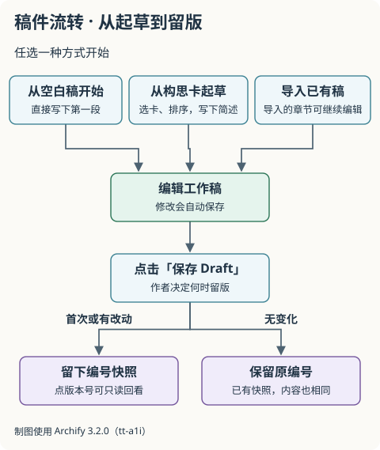
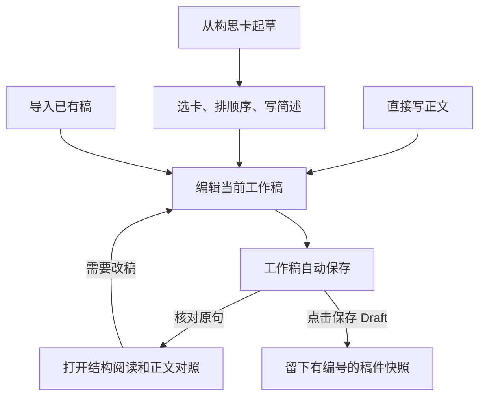

# 稿件流转

在 DSH 打开项目后，可以从空白稿、构思卡或已有稿开始。平时编辑会自动保存；需要留下一份可以回看的整篇稿时，点「保存 Draft」。

**0.13.0 首次公开测试版流程图**（2026-11-20）。使用 Archify 3.2.0（tt-a1i）制作。静态总览和交互版共用一份图源。[打开交互图](figures/manuscript-workflow/workflow.html) · [可编辑图源](figures/manuscript-workflow/workflow.json) · [Archify 上游](https://github.com/tt-a1i/archify) · [工具署名与许可](figures/archify-licenses/NOTICE)

在 GitHub 浏览时可直接看上图。要放大、平移或追踪路径，请下载交互图的 HTML 文件，用浏览器打开。

展开日常编辑流程（含结构阅读与正文对照）

首次试写可以直接输入一句话，点右下角「保存 Draft」，再点版本号打开 Draft 01 的只读快照。

要用一篇有图表、公式和审阅意见的稿件走完这条路，见[杯盖与降温完整示例](../examples/杯盖与降温/README.md)。可以从构思卡起草，也可以打开完成态副本核对两轮稿件。
