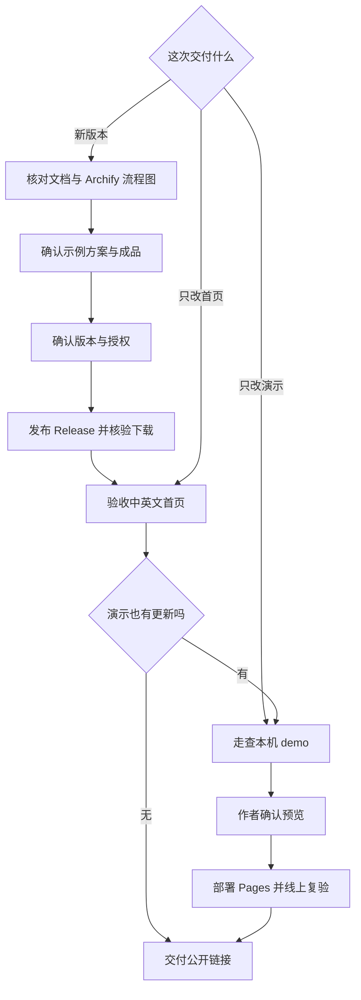

# ManuScript 公开发布指南

下一次发布从这里开始。先定交付范围，再按下表交付给作者确认。仅更新 GitHub 首页时走第 5 步。仅更新在线示例时走第 6 步，并检查第 5 步里受影响的链接。只要插件包内置的示例、工作台或安装内容发生变化，就按产品发版处理。

## 六步发布

| 步骤 | 维护者交付什么 | 作者确认什么 |
|---|---|---|
| 1 · 文档和流程图 | 对照当前实现与实际操作，修正过时步骤。渲染所有受影响的图，按当版程序复走关键分支。准备 Archify 发布图。 | 操作能复现，图的走向、署名和可读性正确。 |
| 2 · 完整示例 | 先列功能和用户路线，再制作原创示例、起点与完成态项目，在干净的安装环境恢复两者。 | 先确认方案，再确认可以独立走完的示例。 |
| 3 · 定版 | 查现有版本与标签，选定后续版本号、发布阶段和授权。同步插件清单、包元数据、构建产物、文档与发布说明，运行开发仓库的检查。 | 版本号、公测或正式版标识、许可证及准备发布的内容。 |
| 4 · GitHub Release | 从审过的公开提交打标签，上传插件、示例、流程图及校验清单。首次公测勾选 **Pre-release**。从 Release 重新下载并核验附件。 | 收到并打开仓库、Release 两个链接，再进入首页制作。 |
| 5 · 仓库首页 | 更新英文默认首页、中文入口、简介、Topics、图标、实机截图、平台说明与 Agent 安装指令。 | 从仓库根页切换两种语言，打开下载、截图与安装入口。 |
| 6 · 交互 demo | 先确认走查路线，再交本机预览。逐项比对当版产品，通过后部署 Pages，从线上重走同一路径。 | 预览确认后再部署；交付可直达示例的公开链接和部署记录。 |

已确认的范围和结论记入完整开发仓库的需求池与迭代日志。再次接手时从第一个未确认的节点继续。如果作者只要求预览，就停在本机预览。

## 文档、图与示例

以一名新用户从打开插件到留下修订稿的实际操作为线索，核对安装说明、菜单、输入、关键选择和结果。每个公开版本都用 Archify 准备流程图。图源、静态总览、独立交互 HTML 放在一起，从流程文档和 Release 都能找到。静态图注和 HTML 注明 Archify、作者、所用版本、上游链接及所依据的 ManuScript 版本，保留分发所需的许可。检查宽屏和窄屏，再沿真实稿件核对分支。现成图可以沿用，须按本版复核。[稿件流转与发布图](07-manuscript-workflow.md) · [图源](figures/manuscript-workflow/workflow.json) · [Archify](https://github.com/tt-a1i/archify)

首次公测的[杯盖与降温示例](../examples/杯盖与降温/README.md)可作为验收基线。它是一篇标明模拟数据的原创短研究论文，含摘要、1 Intro、2 Method、3 Results、4 Discussion、5 Conclusion、6 Data Availability，子节使用 n.n，便于核对导图层级。检查 APA 第 7 版引用、参考文献、图片、表格、公式、证据 PDF、原始数据和附件能从正文或示例说明找到。引用真实方法文献时核对来源，明确区分模拟数据与引用的研究。

两份 Draft 应能解释一次真实可见的修改。保留送阅稿、带批注的 Word 回稿、作者的处理决定和完成态。核对「章节导图 → 正文 → 引文所在 PDF 页 → 返修对照」，以及「结构阅读 → 段落 → 原句 → 两版差异」。替换示例时，同步核对插件内置副本、展示截图、Release 附件和网页演示引用的章节与句子。

## 定版、打包与发布

1. 在完整开发仓库按接手指南配置 Node 和 Python，依次运行 `npm run doctor`、`npm run build`、`npm run check`、`npm test`。记录实际运行的平台、宿主和结果。核对 `packages/ManuScript/package.json`、`.codex-plugin/plugin.json`（插件目录内）以及构建后的入口是否属于同一版。
2. 在干净的公开仓库检出中检查远端、分支、差异与待打标签的提交。只同步审过的公开源码、文档、原创材料和可分发的依赖。核对项目 LICENSE、第三方声明和示例授权。从插件目录运行 `npm pack`，实际安装生成的包，恢复示例，在支持的平台上复走主线。
3. 以 v0.13.0 为例，四件附件为 `manuscript-0.13.0.tgz`、`ManuScript-0.13.0-example.zip`、`ManuScript-0.13.0-workflow.zip`、`SHA256SUMS.txt`。先生成前三件，再计算它们的 SHA-256。确认后发布；说明中写清阶段、安装入口、示例、平台实测范围和已知限制。
4. 从公开 Release 下载四件附件，在下载目录用 macOS 的 `shasum -a 256 -c SHA256SUMS.txt` 或 Windows PowerShell 的 `Get-FileHash -Algorithm SHA256 -Path *.tgz,*.zip` 核对。打开两个 ZIP，验收示例能恢复、图能离线打开。记录标签指向的提交和 Release 链接。常规修订发新版本。作者要求同版本重发时，先逐项确认要替换的标签、Release 和附件，并说明旧提交指向及校验值会变化。

## GitHub 首页

- 默认分支的 `README.md` 使用英文，顶部放「简体中文」链接到 `README.zh-CN.md`。中文页同一位置链接回英文。旧 `README.en.md` 保留导航。两页按同一路线介绍产品状态、在线演示、下载与安装；语言切换用相对链接。
- GitHub About 用一句英文说明用途，Website 指向公开 demo，Topics 选与产品和宿主相符的关键词。在未经登录的浏览器从仓库根页验收双向切换。
- 首页和 demo 使用发布插件的[产品图标](../packages/ManuScript/assets/logo.svg)。从本次发布包载入对应示例，截取能读出章节名、表格、来源页和返修位置的实机画面。内容变化时采用新文件名，避免缓存显示旧图；写清版本、宿主、系统和替代文本。
- 英文和中文各保留一段可直接复制给 Agent 的安装指令。说明怎样选择 Codex 或 DSH，macOS 和 Windows 分别需要什么、如何验证成功；注明已实测和待实测的组合。从两页分别点击安装、Release 和演示链接。

## 预整理的在线 demo

1. 以目标标签的安装包和完成态项目为基准。运行 `python3 demo/prepare.py` 生成正文、引文和演示素材。该脚本还使用 Pandoc 和 Poppler。Windows 使用配置好依赖的 Python，例如 `py -3`。
2. 按各版实际正文维护[段落解读和原句](../demo/authoring/structure-notes.json)，在[整理结果构建脚本](../demo/authoring/build_reading.py)维护全文问题、分组和章节关联。运行 `python3 demo/prepare_structure.py <已解包插件目录>`；路径应直接包含 `workbench`。脚本核对已编译工作台的摘要，并用该版插件的整理操作验证段落、关系和原句。换版本时先比较工作台接口，再更新摘要和适配代码。
3. 打开新浏览器会话，第一次点「结构阅读」就应看到全文问题、章节关系、段落作用和段内逻辑。以 4.1 第二段为例，点逻辑节点、定位正文、查看该句的 Word 批注及两版表述。切换 Draft 后原句随版本变化。修改工作稿后应提示相关整理已过时，冻结稿仍可回看。网页加载随示例准备好的解读，重新调用模型需在宿主中操作。
4. 在已安装项目依赖及 Chrome 的环境开两个终端。运行 `node scripts/preview-release-demo.mjs <已解包插件目录>` 启动[原版工作台](../scripts/preview-release-demo.mjs)。另运行 `python3 -m http.server 8000 --bind 127.0.0.1 --directory demo`，静态地址为 `http://127.0.0.1:8000/`。运行[浏览器走查](../verification/ManuScript/public-demo/structure.cjs)命令 `node verification/ManuScript/public-demo/structure.cjs <静态地址> <原版工作台输出的本机地址>`，两个地址都保留末尾斜线。覆盖中英文、桌面与窄屏、编辑／阅读、引文页、三档结构阅读和返修。记录网页与安装版各自可操作的范围，将预览交作者确认。
5. 公开仓库的 `main` 保存 demo 源码、素材与生成脚本；`gh-pages` 的根目录放 `demo/` 下的运行文件和资源，并保留 `.nojekyll` 与许可证。发布内容排除 Python 构建脚本、`authoring/`、临时文件和本机数据。检查分支差异后快进推送。用 `gh api repos/RJ2045-PRC/ManuScript/pages/builds/latest` 核对部署状态和提交，再以公开 URL 代入上一步走查。最终交付仓库、所涉 Release、Pages 及对应部署记录。

## 下一次可以直接交给 Agent 的说明

> 请按项目公开发布指南准备下一版 ManuScript。先检查最新标签、待发布改动、示例和已有确认记录，告诉我这次从哪一步开始，以及哪些材料能复用。每步给我可检查的产物和验证结果，等我确认再进入下一步。先给本机 demo 预览，收到确认后再发布 GitHub Pages。最后给我仓库、Release 和在线 demo 链接，以及仍待实测的平台或宿主。
