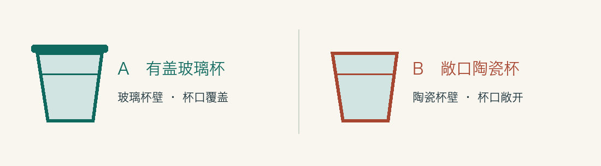

# 杯盖会让水凉得更慢吗？

首稿的讨论里有一句「杯盖减缓了降温。」审阅人追问：如果两只杯子的材质也不同，哪一次比较能单独回答杯盖的问题？你将从同一篇稿子的两项研究中找证据，改写这句话，并把答复留在修订版里。

[阅读修订稿 PDF](稿件/Draft-02-修订稿.pdf) · [在线阅读 Markdown](稿件/Draft-02.md)

| 论文里的问题 | 可以核查的材料 |
|---|---|
| 有盖玻璃杯与敞口陶瓷杯在十分钟内怎样降温？ | 研究一的[装置与读数记录](材料/课堂测量记录.pdf)和[六轮温度表](材料/温度记录.csv)。在图 2 中，一行连接同一轮的两只杯子。 |
| 给同一只杯加盖，十分钟终温能差多少？ | 研究二的[八组交叉实验](材料/交叉实验.csv)和[图 3](材料/crossover.png)。在同一区组按杯体找出两次读数，再用有盖终温减敞口终温。 |
| 数字和引文可以复核吗？ | 两份 CSV 和[复算脚本](材料/复算.py)下载到同一目录后运行 `python3 复算.py`（Windows 可用 `py 复算.py`）。正文按 APA 第 7 版引用五篇实际发表的论文，DOI 见文末[书目](稿件/Draft-02.md#参考文献)；另有一条自编课堂记录供练习定位页码。 |

论文、数据与三张图均为本案例原创。两项研究均未实施实物实验；文献提供方法与物理背景。报告结构借鉴 [APA 定量研究报告标准](https://apastyle.apa.org/jars/quantitative)，期刊文献条目参照 [APA 第 7 版期刊文章范例](https://apastyle.apa.org/style-grammar-guidelines/references/examples/journal-article-references)。

## 选择入口

| 我想做什么 | 从哪里开始 |
|---|---|
| 亲手写、核对、修订 | 下载[起点项目.zip](起点项目.zip)、[可复制的首稿源码](材料/首稿源码.txt)和[Word 审阅回稿](稿件/Draft-01-审阅回稿.docx)。起点包内有三张构思卡、三张插图、六条书目、自编来源 PDF 和两份 CSV，留给你一份空白工作稿。 |
| 直接探索已经完成的项目 | 下载[完成态项目.zip](完成态项目.zip)。里面有两版 Draft、带出处的引文、写作记录、已处理的返修意见，以及一份待核对的练习建议。 |
| 先在 GitHub 上读 | 打开[首稿](稿件/Draft-01.md)，再读[装置与读数记录](材料/课堂测量记录.pdf)和[修订稿](稿件/Draft-02.md)。[送阅 Word](稿件/Draft-01-送阅稿.docx)和[修订 PDF](稿件/Draft-02-修订稿.pdf)可直接下载。 |

## 恢复到本机 DSH

以下路径使用已装好 ManuScript 的 **DSH Web**。浏览器中的工作台与同一 DSH 实例共享项目。下载 ZIP 时在 GitHub 文件页选择下载原文件，保持压缩包完整。

1. 在已经登录的本机 DSH Web 浏览器里另开一个标签页。保留原地址的协议、主机和端口，把路径改成 `/api/manuscript.workspace`，去掉原查询参数。看到「恢复项目包」后选择起点 ZIP，点「确定」。保留这个标签页，后面用它接回审阅意见。
2. 回到原来的 DSH 标签页，点侧栏「ManuScript」进入项目库。若之前已经打开项目库，刷新后再进入。选「杯盖与降温 · 起点（恢复副本）」，首次进入时为它选一个新的空文件夹。
3. 想同时对照完成态时，用相同步骤恢复另一个 ZIP，为它选择另一个空文件夹。两个副本可以独立修改。宿主要求与启动步骤见[安装指南](../../README.md)。

## 从选卡到第二版交付

1. **从两张卡写一句简述。** 在同一 DSH Web 地址另开 `/api/manuscript.workspace?view=map`，从项目下拉框选起点副本。点「研究问题 → 写这一节」，展开章节编辑器里的「写作思路」。依次把「研究问题」「温度观察」加入链条，填写各自的连接理由。在「作者简述」写下「先比较两杯的起止温度，再判断差异能说明什么」，点章节的「保存」。「可能解释」可以留在图上。这里会留下 Markdown 写作记录，编号 Draft 仍为零。
2. **留一份真正能送阅的首稿。** 回到侧栏的 ManuScript，重新进入起点副本。点「正文编辑 → 更多 → 源码模式」，把[首稿源码](材料/首稿源码.txt)的全部内容粘进稿面。它引用起点包内已有的图片和固定文献片段。切回编辑或阅读模式，核对三张图、两条独立公式与三张数据表，再点右下角「保存 Draft」。点版本号能回看 Draft 01；不改内容再保存，仍只有一个编号。可以从「更多」的导出入口另存 Word，与[送阅稿](稿件/Draft-01-送阅稿.docx)对照。也可自行写段落、从图表库插图，保留讨论中的首稿原句即可继续做返修练习。
3. **接回旧版的意见。** 在第一个工作台标签页选起点副本，刷新并打开「返修对照 → 导入反馈文件」。选[Word 审阅回稿](稿件/Draft-01-审阅回稿.docx)，用途选「对旧版的反馈」，针对版本选标签为 **Draft 01** 的那一行。意见应显示原句「杯盖减缓了降温。」和关于材质的追问。如果自己改写了这句，可以在意见处「手动定位」到讨论章节。
4. **用原始材料回答审阅人。** 在稿件标签页打开「结构阅读 → 正文对照」，找到讨论里的原句。回「正文编辑」核对装置段的引文（阅读模式单击引文，编辑模式用「查看来源」）。第 1 页记录盖子和材质都不同。结果段的引文指向第 2 页。用[原始 CSV](材料/温度记录.csv)复算首轮速率，A 杯为 (80 − 72) / 10 = **0.8 °C/min**，B 杯为 (80 − 68) / 10 = **1.2 °C/min**。再按轮将 A 杯终点温度减去 B 杯温度，六个差值平均为 **3.83 °C**。再打开研究二的交叉实验记录。第 1 组的玻璃杯有盖为 72.0 °C、敞口为 70.0 °C，差为 **2.0 °C**。借助这两种对照，指出哪项研究支持哪一句结论。
5. **保存修订并检查交付件。** 在当前工作稿中改写讨论，点「保存 Draft」留下 Draft 02。打开版本列表回看 Draft 01，应仍能读到原判断。在「返修对照 → 记录决定」中选「采纳」，选 Draft 02，写明改了哪句话、为什么改。导出 PDF，检查三张图、两条公式与 APA 作者—年份引文，并核对文末 DOI。可与[完成态 PDF](稿件/Draft-02-修订稿.pdf)核对。

## 还可以在完成态体验什么

| 操作 | 可以观察到的结果 |
|---|---|
| 在结构阅读切换「全文结构」「段落卡片」「段内逻辑」，打开正文对照；在正文的「更多」中选择「本章折叠写作」 | 可以沿同一篇稿切换阅读尺度、定位原段、摘句修改。打开这些视图不会新增 Draft。 |
| 从「更多 → 稿件管理」定位插图和独立公式，查看原图，再切换引用样式 | 三幅图和两条公式来自当前稿面，引用样式同时影响文内与文末。本地可定位页码的附件是[课堂测量记录](材料/课堂测量记录.pdf)，另提供[BibTeX](材料/课堂测量记录.bib)。 |
| 打开「Agent 建议」，对照讨论段、原始候选和核对稿 | 有一份人工预置的建议，提出增加每种材质的杯体数量，以区分杯与杯之间的差异和同一杯的轮间波动。可采用、编辑或暂存；练习用建议未调用模型。 |
| 在管理工作台从「文献与经验 → 导入稿件 / 文献 / 反馈」导入 Word 或 Markdown 主稿；从「文献与经验」备份整个项目，再恢复副本 | 建议在另一个副本里演练。导入时选择「作者新稿」与新增章节；备份恢复后可检查两版 Draft、意见和原始附件。 |
| 配置模型后试用团队派工、附选区讨论、整理结构或翻译选段；按项目设置开启思路回看 | 这些入口依赖宿主配置及可用材料，生成内容需要作者核对。基础练习可以离线完成。[团队分工](../../docs/01-README.md#配置支持-agent-和自建角色) · [思路回看](../../docs/01-README.md#dsh-思路回看) |

可对照[已确认的稿件流转图](../../docs/07-manuscript-workflow.md)理解工作稿、自动保存和编号 Draft 的关系。
